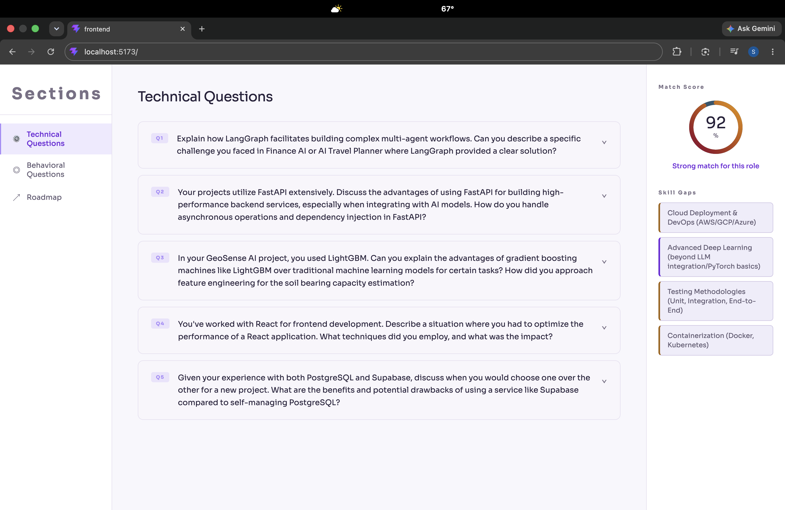
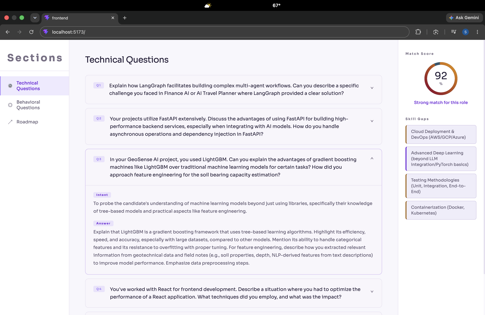
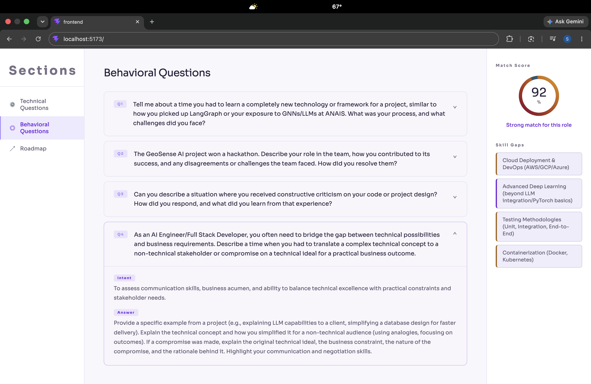
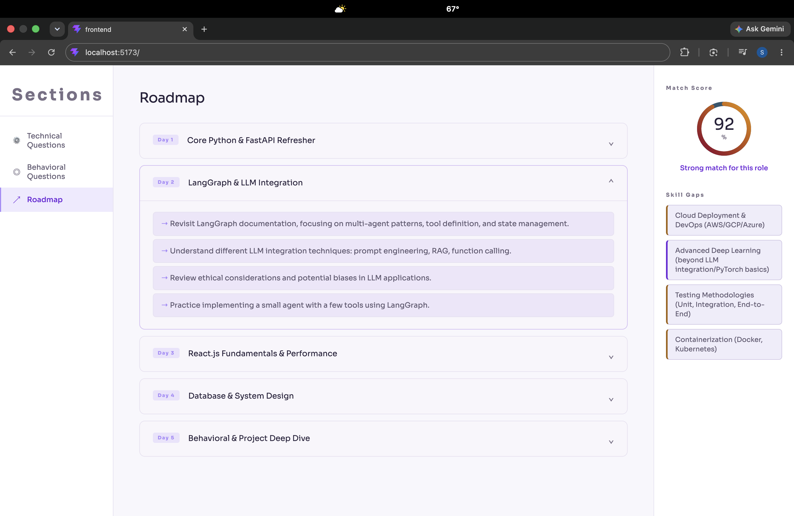
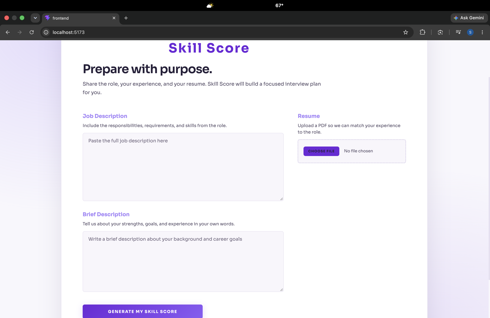
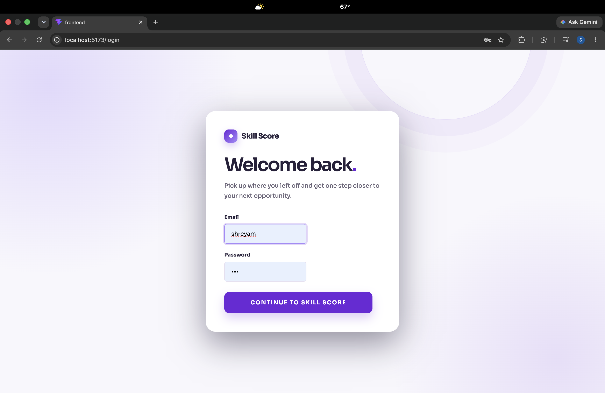
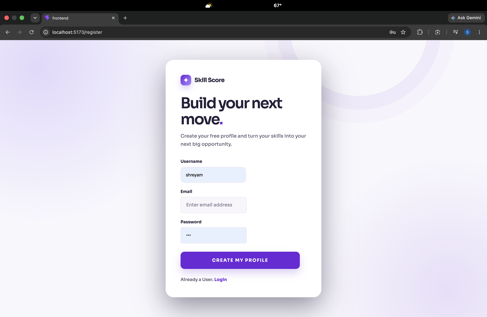
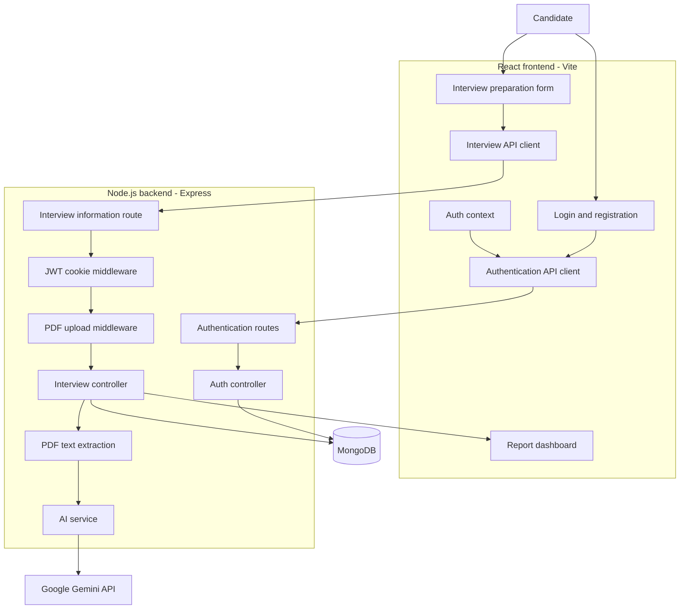

# Skill Score

Skill Score is an AI-powered interview preparation app. It compares a job description with a candidate's resume and self-description, then creates a practical interview report with:

- A match score
- Technical interview questions
- Behavioural interview questions
- Skill gaps
- A day-by-day preparation roadmap

The application has a React frontend and an Express/MongoDB backend. The backend extracts text from an uploaded PDF resume and sends the combined information to Google Gemini for structured report generation.

## Screenshots

### Authentication





### Interview preparation





### Generated report







## Architecture



### Request flow

1. A user registers or logs in.
2. The backend stores the user in MongoDB and sends an authentication cookie.
3. The user submits a job description, a PDF resume, and a brief self-description.
4. The backend checks authentication and reads the resume PDF.
5. The AI service sends the extracted resume text and user inputs to Gemini.
6. The generated report is saved for the user in MongoDB.
7. The frontend displays the score, questions, skill gaps, and roadmap.

## Project structure

```text
.
├── backend/
│   ├── server.js
│   └── src/
│       ├── app.js
│       ├── config/
│       ├── controllers/
│       ├── middlewares/
│       ├── models/
│       ├── routes/
│       └── services-ai/
├── frontend/
│   ├── src/
│   │   ├── features/auth/
│   │   └── features/ai/
│   └── package.json
├── images/
└── README.md
```

## Requirements

- Node.js 18 or newer
- npm
- MongoDB, either local or hosted
- Google Gemini API key

## Getting started

### 1. Clone the project

```bash
git clone <repository-url>
cd Job-Skill-Match-Project
```

### 2. Install backend dependencies

```bash
cd backend
npm install
```

Create `backend/.env`:

```env
MONGO_URI=mongodb://127.0.0.1:27017/job-skill-match
JWT_SECRET=replace_with_a_long_random_secret
GOOGLE_GENAI_API_KEY=replace_with_your_gemini_api_key
```

Start the backend:

```bash
npm run dev
```

The API runs at `http://localhost:3000`.

### 3. Install frontend dependencies

Open another terminal:

```bash
cd frontend
npm install
npm run dev
```

The frontend runs at the Vite URL shown in the terminal, normally `http://localhost:5173`.

## Available API routes

| Method | Route | Purpose |
| --- | --- | --- |
| `POST` | `/api/auth/register` | Create a user account |
| `POST` | `/api/auth/login` | Log in and set the auth cookie |
| `GET` | `/api/auth/get-me` | Get the current user |
| `GET` | `/api/auth/logout` | Clear the auth cookie |
| `POST` | `/api/interview/information` | Upload a resume and generate a report |

The interview route requires authentication and accepts a multipart form with `jobDescription`, `selfDescription`, and `resume`.

## Useful commands

### Frontend

```bash
npm run dev
npm run build
npm run lint
npm run preview
```

### Backend

```bash
npm run dev
```

## Security notes

- Do not commit `backend/.env`.
- Keep API keys and JWT secrets outside source control.
- Use a strong, private `JWT_SECRET`.
- In production, replace localhost URLs and configure a production CORS origin.
- Validate uploaded files and request limits before deploying publicly.

## Creator

Created by **Shreyam Regmi**.

## License

This project is available under the [MIT License](./LICENSE).
